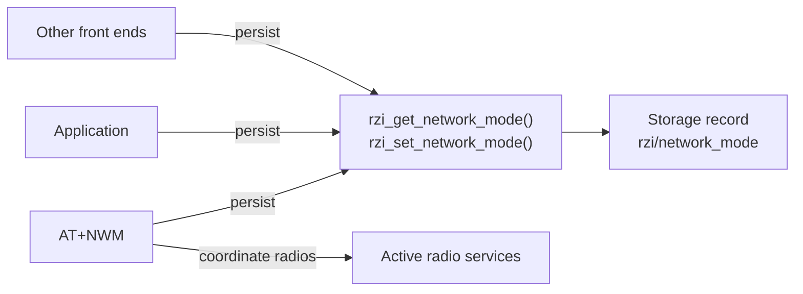
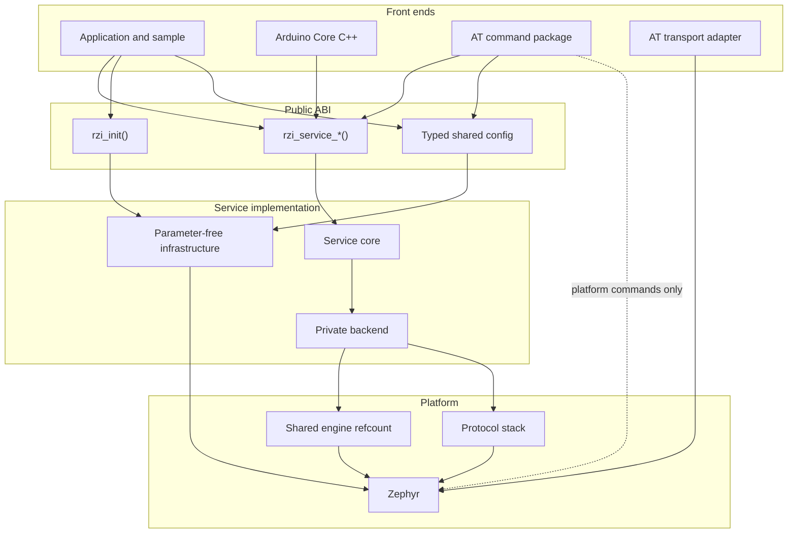
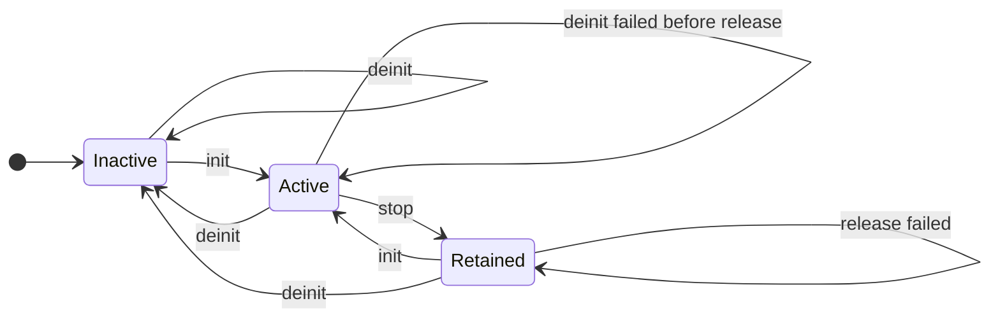
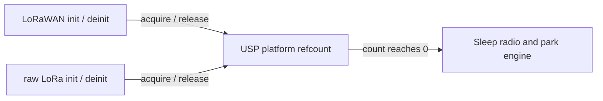
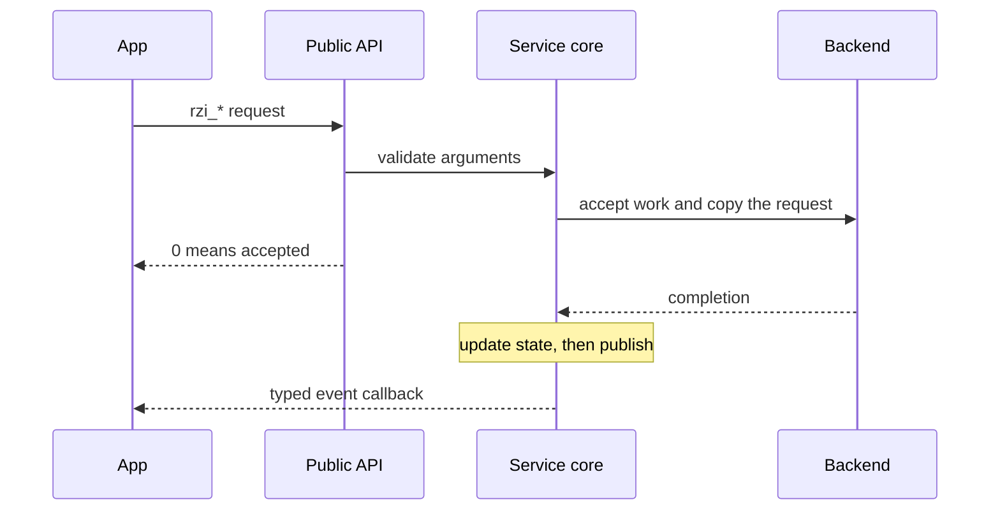

# API design

Status: normative

Design framework for every public RZI C API. Numeric error values, Doxygen
tag syntax, and per-service field lists stay in the linked documents. Those
documents specify their own scope.

See also: [architecture.md](./architecture.md),
[coding-standards.md](./coding-standards.md),
[api-docs.md](./api-docs.md),
[error-codes.md](./error-codes.md),
[network-mode-api.md](./network-mode-api.md),
[at-framework.md](./at-framework.md).

## 1. What a public API is

`include/rzi/` is the ABI. Applications and samples include only
`<rzi/...>`. Headers are C, with `#ifndef` guards and C++ `extern "C"`
guards. They contain RZI types, standard C types, and only unavoidable
stable Zephyr types at an I/O boundary, such as `struct device`.

A public operation is a supported RAK product capability. RZI is not a
one-to-one wrapper for USP, LBM, loramac-node, or a Zephyr subsystem.
Public names stay source-compatible within one major version and must not
carry a backend, board, vendor, or protocol-stack name.

RZI owns the meaning of the call: validation, `RZI_ERR_*` behavior, service
lifecycle, application-visible state, and events. A backend translates that
contract onto one stack. The stack, its scheduler, and its private types
stay behind the service.

## 2. Design intent

These rules come from the public-contract decisions already recorded in the
service lifecycle, shared-engine, and AT ownership changes.

**One fact has one owner.** A value that more than one front end must share
gets a typed public API. That API owns the storage namespace, record
version, representation, and validation. AT, BLE, Shell, and applications
call it. They do not invent a private key for the same fact. Network working
mode is the instance: `rzi_get_network_mode()` / `rzi_set_network_mode()`
persist the mode, and `AT+NWM` only coordinates the active radio around that
value. The persistence call does not start or stop a radio service.



**Bring-up is `init`, and a failed `init` stays retryable.** A one-shot
startup is initialization, not a second processing phase, so the public verb
is `init`. `rzi_init()` prepares only parameter-free shared infrastructure,
such as storage, so boot can fail early. The service that owns configuration
or active hardware starts itself. Failure leaves that service in a state the
caller can try again.

**One service has one queryable lifecycle.** The service core owns the
authoritative state. Queries read it. Each actual transition is published
after the state is updated. AT, FUOTA, and other dependents follow those
transitions. Backend flags such as `active` or `joined` stay private.

**`stop` keeps the contract. `deinit` releases the shared engine.** `stop`
ends active work and retains configuration and subscribers so a later `init`
can run. `deinit` also drops backend references and application callback
tables. LoRaWAN and raw LoRa share one radio engine. The platform
reference-counts those users; the last release sleeps the radio and parks
the engine. Callers can query whether the service is still active. A backend
that cannot stop safely returns `-RZI_ERR_NOT_SUPPORTED` and leaves the last
usable state in place.

**Shared platform setup is fallible.** Radio or modem init returns an error
the caller can retry. Each service takes and drops its reference inside its
own lifecycle. Until it does, its backend only propagates that platform
error.

**One command name has one token.** An AT descriptor is the source of the
command name, help, allowed operations, and handler. A value reply is built
from that same name token with `RZI_AT_VALUE`, so the registered command and
the `AT+` line stay the same string.

## 3. Layers

Dependencies point inward. Code must not skip a layer.



| Caller | May use | Must not use |
|---|---|---|
| Application, sample | `<rzi/...>` | Private headers, `settings_*`, `smtc_*`, `LoRaMac*`, Zephyr `lorawan_*` / `lora_*` |
| AT command package | AT private contracts and public `<rzi/...>` | Private service or backend headers, Settings, protocol stacks, radio drivers |
| AT transport adapter | Public AT headers and its Zephyr transport API | Business-service backends |
| Service core | Its private headers and its backend contract | Another service's private headers |
| Backend | The selected stack and Zephyr facilities it must map | A second public source of lifecycle state |

AT is an inbound adapter, not a core service. A command that needs Storage,
Power, LoRaWAN, raw LoRa, or FUOTA calls that service's public API. Shared
configuration keys belong to the typed service that owns them. An adapter
must not invent that service's storage namespace, key, representation, or
migration.

Transport and platform calls that no RZI service owns stay inside the
matching adapter or system-command file: UART or BLE transport, reboot,
hardware identity, UART configuration, Bluetooth identity.

## 4. Where the API lives

One public subdirectory per service. Module-level headers with no owning
service stay directly under `include/rzi/`.

```text
include/rzi/
├── err.h                      Closed error catalog
├── init.h                     Parameter-free shared infrastructure
├── version.h                  SDK version
├── network_mode.h             Network working-mode persistence
├── lorawan/lorawan.h          LoRaWAN service
├── lorawan/multicast.h
├── lorawan/certification.h
├── lorawan/fuota.h
├── lora/lora.h                Raw LoRa / FSK
├── at/at.h                    AT lifecycle
├── at/uart.h                  UART adapter
├── storage/storage.h
└── power/power.h
```

Private headers sit next to the implementation. They enter `include/rzi/`
only together with a callable public contract. `src/common/` implements
module-level public headers only. It is not a shared-helper directory.

`rzi_init()` prepares parameter-free shared infrastructure, such as
storage, and may run eagerly and repeatedly. LoRaWAN, raw LoRa, AT, and any
service that needs configuration or owns active hardware keeps its own
`init`.

## 5. Lifecycle

A service with a public lifecycle has exactly one authoritative state, owned
by the service core. Queries and lifecycle events read or originate from
that state. A backend may keep private flags. Those flags are not a second
public source of truth.

Backend callbacks request a fact or a transition. The service core validates
and applies it. The state is updated before the documented state-change
event is delivered. Receive activity, retry counts, and queued work stay
out of the lifecycle enum unless they change which public operations are
valid.

`stop` and `deinit` serialize with callbacks and in-flight backend work.
If either fails, ownership and the last usable lifecycle state stay
retryable. An API that waits for its own dispatcher rejects calls made from
that dispatcher's callbacks.



`Inactive` means this service does not hold the shared engine. `Retained`
means `stop` succeeded: active work has ended, and configuration,
subscribers, and the engine reference remain. `Active` means `init`
succeeded. `stop` is idempotent when the service is already stopped.
`deinit` is idempotent only after the reference is already released. A
second `init` while the service is active returns `-RZI_ERR_ALREADY`.

LoRaWAN and raw LoRa take the engine reference in `init` only when they do
not already hold it, and they drop it in `deinit`. `stop` does not change
the count. The last release sleeps the radio and parks the engine.



Lifecycle verbs:

| Verb | Meaning |
|---|---|
| `init` | Bring the service up. A failure is retryable. A second `init` while active returns `-RZI_ERR_ALREADY`. |
| `stop` | End active processing. Drain callbacks. Keep configuration, subscribers, and the engine reference. A later `init` is valid. |
| `deinit` | Stop, then release backend references and application callback tables. The last shared-engine user sleeps the radio. |

Expose `start` only when initialization and processing are distinct phases.
One-shot startup uses `init`.

## 6. Names

Every public symbol starts with `rzi_` or `RZI_`. Source identifiers are
English ASCII. Names describe the responsibility. Established domain words
may stay: `AT`, `EUI`, `FUOTA`, `NVM`, `UART`, `USB`, `USP`, `LoRaWAN`.

| Kind | Form | Example |
|---|---|---|
| Service function | `rzi_<service>_<operation>()` | `rzi_lorawan_join()` |
| Module-level function | `rzi_<operation>()` | `rzi_init()` |
| Struct tag | `struct rzi_<service>_<noun>` | `struct rzi_lorawan_event` |
| Enum tag | `enum rzi_<service>_<noun>` | `enum rzi_err` |
| Callback typedef | `rzi_<service>_<purpose>_handler_t` | ends in `_t` |
| Constant, enumerator | `RZI_<SERVICE>_<NAME>` | `RZI_LORAWAN_REGION_EU_868` |
| Header guard | Include path, uppercased | `RZI_LORAWAN_LORAWAN_H` |

Operation verbs:

- `get_<noun>` copies into an output parameter. `set_<noun>` changes an existing setting. `is_<state>` is a boolean query.
- One spelling per operation. Do not ship both `get_status` and `status_get`.
- Do not add per-setting `load`, `save`, or `clear` when get/set is the contract. Factory reset belongs to the owning reset flow. `rzi_storage_read()` and `rzi_storage_write()` stay, because transport is the storage contract.
- Do not invent a service prefix for a module-level operation.
- An AT command module is named `at_<area>`, matching the other command sources.
- A value reply uses the registered command-name token. Do not repeat the name as a second literal.

Typedefs end in `_t`. Struct and enum tags do not.

Kconfig is `RZI_<SERVICE>_<OPTION>`, one `zephyr/Kconfig.<service>` per
service. Child options keep the full parent prefix.

## 7. Call contract

Public functions return `0` (`RZI_SUCCESS`) or the negation of one
`enum rzi_err` value. Catalog integers start at 1000 so a leaked Zephyr
errno cannot alias an RZI code. Do not return POSIX errno and do not
forward a vendor code. Unknown vendor codes become `-RZI_ERR_IO` at the
service or backend boundary. The closed list and the errno map are in
[error-codes.md](./error-codes.md). Each function documents the subset it
actually returns.

Before a backend is entered:

- validate arguments, enums, sizes, and ports;
- reject an ISR caller of a thread-context API with `-RZI_ERR_ISR`.

Asynchrony:



- If `0` means "request accepted", the header says so. Completion is a typed event. Callers do not infer completion from the return value.
- Copy asynchronous request data before return, or fix its lifetime in the contract.
- Pointers passed into a callback are valid only for that invocation. Data that must outlive the call is copied.
- Callbacks run serially on the documented thread. The contract states whether the callback may block and whether it may re-enter RZI.
- Cross-thread queues have a fixed length. Overflow is observable. Silent loss without a query path is not part of the contract.
- The base configuration does not allocate on the heap for the call.

Concurrency defaults to thread context. Lock scope stays in the
implementation. A public API that can re-enter the same service is not
called while that service's lock is held, unless the API's contract allows
it. A helper whose name ends in `_locked` assumes the caller already holds
the named lock.

Results the caller must consume use `__must_check`. Variadic format
functions use `__printf_like`. Public APIs run in supervisor mode and do
not use `__syscall`.

## 8. Documentation and versions

Every production-library `.c` and `.h` file has `@file` and `@brief`. Each
public header joins one service `@defgroup` with `@since` and `@version`,
and closes the group with `/** @} */`. Private files do not open a public
group.

Every public function documents `@brief`, each `@param` (direction, range,
ownership, lifetime), `@retval` or `@return`, thread context, and whether
`0` means done or accepted. Callbacks document their thread, whether a lock
is held, re-entry, pointer lifetime, and whether they may block.

New groups carry `@since`. A symbol added later carries its own `@since`.
`@version` is the current semantic version of that API set. A deprecated
API has both `@deprecated` and `__deprecated`, names its replacement, and
names the major version that removes it. It stays for at least one release
cycle after RZI has promised a stable ABI.

Annotation syntax and the review list are in
[api-docs.md](./api-docs.md). Generate the HTML manual with
`tools/docs/generate-doxygen.sh`. Output is not committed.

## 9. Adding or changing an API

1. Put the declaration in the owning public header. Add the header only when the service does not already have one.
2. Name it with `rzi_` / `RZI_` and a single operation verb. Leave backend and board names out.
3. If several front ends share the fact, give it one typed API and keep adapters on that API.
4. Validate in the service core. Map stack errors at the backend boundary. A failed `init` stays retryable.
5. Give the service one lifecycle state if the call creates, stops, or queries one. Publish each transition from that state.
6. Use `stop` to retain configuration and `deinit` to release a shared engine reference.
7. Document the synchronous result and, when the work continues, the completion event.
8. Update the matching service page under `doc/` in the same change.
9. Cover the contract from `samples/` or `tests/` through `<rzi/...>`, not through a backend header.

Service contracts:

| API | Document |
|---|---|
| `rzi_lorawan_*` | [lorawan-api.md](./lorawan-api.md) |
| `rzi_lora_*` | [lora-api.md](./lora-api.md) |
| `rzi_storage_*` | [storage-api.md](./storage-api.md) |
| `rzi_power_*` | [power-api.md](./power-api.md) |
| Network mode | [network-mode-api.md](./network-mode-api.md) |
| AT command surface | [at-framework.md](./at-framework.md) |
